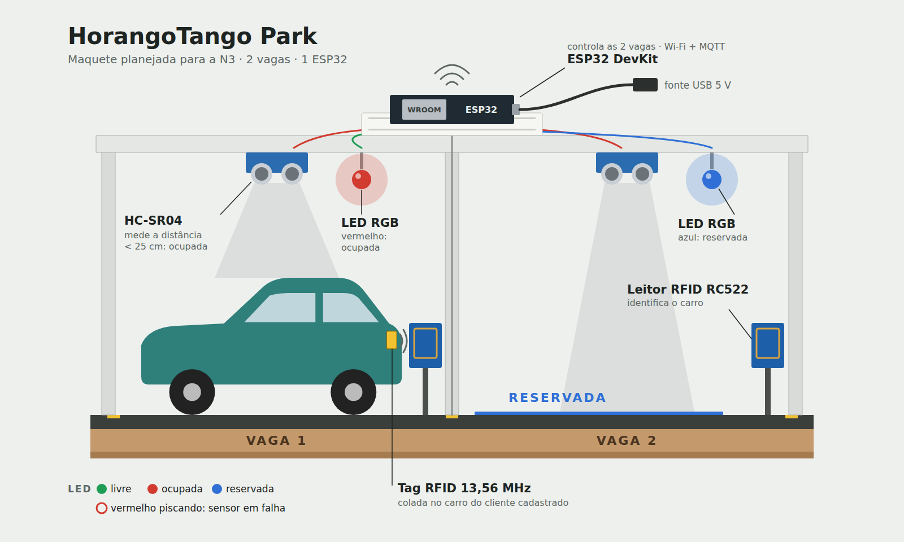
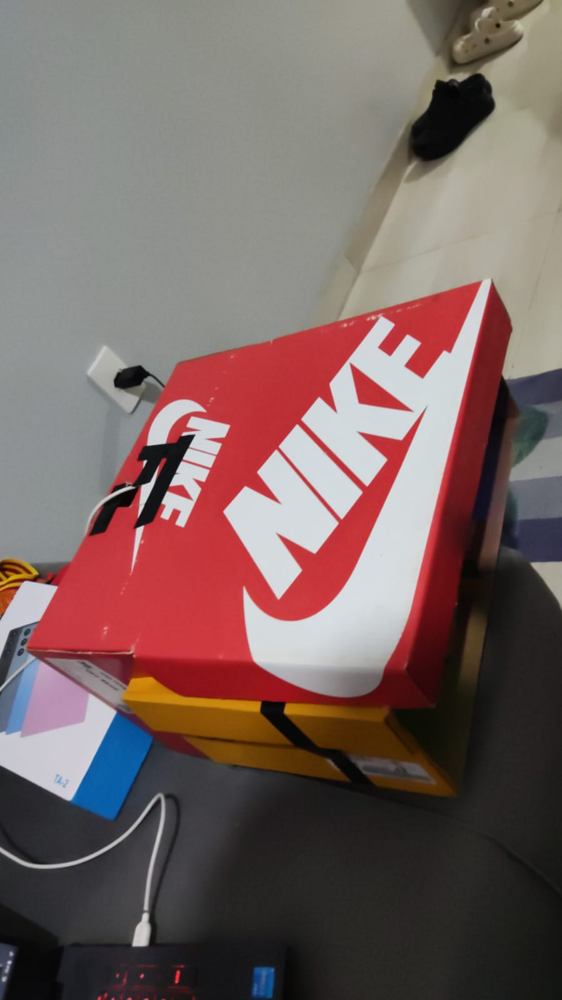
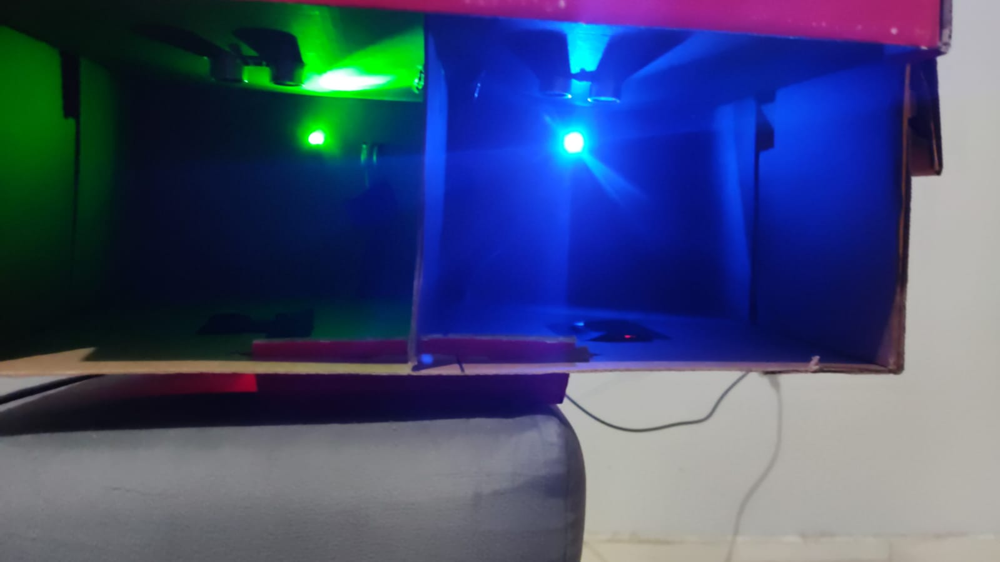

# iotHorangoTango

Sistema IoT de monitoramento de vagas de estacionamento, usando
sensores ultrassônicos, leitores RFID, ESP32 e comunicação via MQTT.

## Sobre o projeto

Este repositório contém o projeto desenvolvido para a disciplina de
Internet das Coisas (N1) da Universidade Católica de Santa Catarina. O
sistema monitora em tempo real a ocupação das vagas de uma garagem
inteligente: um sensor ultrassônico HC-SR04 detecta a presença de
veículo em cada vaga, e um leitor RFID RC522 identifica os carros que
possuem tag. Um único ESP32 processa as leituras das duas vagas,
publica o estado (livre/ocupada) e as tags lidas em um broker MQTT, e
aciona um LED RGB por vaga a partir do que recebe do broker. Dessa
forma, motoristas podem consultar previamente quais vagas estão
disponíveis antes de entrar no estacionamento, e os LEDs orientam quem
já está circulando pela garagem.



*Maquete planejada para a N3 (ilustração conceitual, conforme o
[CP12](docs/CP12.md)).*

O RFID é um complemento: carro sem tag é detectado normalmente pelo
ultrassônico. A tag apenas identifica o veículo, para que motoristas
cadastrados recebam privilégios (ainda a definir). A decisão está
registrada em [docs/adr/0001-rfid-e-app-motorista.md](docs/adr/0001-rfid-e-app-motorista.md).

**Autores:** Gustavo Vinicius Taques, Luis Fernando Pereira, João Pedro
Angelico, Vynicyus Candido.

## Problema, usuário e rumo do projeto (N1 → N3)

- **Problema:** em garagens, o motorista perde tempo procurando vaga e o
  operador não sabe em tempo real quantas vagas estão livres.
- **Usuários:** o **motorista** (consulta vagas livres no celular,
  reserva uma vaga com a sua tag cadastrada e é guiado pelos LEDs) e o
  **operador/administrador** do estacionamento (monitora, configura,
  cadastra tags e reserva vagas).
- **Estado atual (herdado da N1):** ESP32 com HC-SR04 publicando o
  estado de cada vaga em MQTT, LEDs indicando livre/ocupada via broker,
  app web de vagas livres e broker Mosquitto local. Já evoluído neste
  repositório: firmware único para 2 vagas com RFID (identificação do
  carro com tag) e LED RGB.
- **Para onde vai (N3):** produto **HorangoTango Park** — backend
  FastAPI que valida e grava tudo no PostgreSQL, painel do operador com
  login, histórico e gráficos, reserva de vaga com confirmação do
  hardware (LED azul), app do motorista, contrato MQTT em JSON
  versionado, regra local sem rede no firmware, alertas no Telegram,
  OTA, Docker Compose e CI.
- **Proposta completa (CP12):** [docs/CP12.md](docs/CP12.md).

## Como funciona

Um ESP32 cuida das duas vagas (`src/garagem/garagem.ino`) e segue o
contrato MQTT v1 ([CONTRATOS.md](CONTRATOS.md)). Sensores e LEDs
funcionam sem rede; o que acontece com o sistema fora do ar vai para
uma fila e é publicado quando o broker volta
([ADR 0003](docs/adr/0003-firmware-v1-fila-de-eventos.md)).

**Ultrassônico — estado da vaga**

1. **Leitura dos sensores** — a cada 1 s o ESP32 dispara o HC-SR04 de
   cada vaga, um de cada vez (para um não captar o eco do outro), e
   mede a distância até o objeto à frente (o chão da vaga, ou um
   veículo estacionado).
2. **Histerese** — abaixo de 25 cm a vaga passa a ocupada, acima de
   35 cm passa a livre, e entre os dois mantém o estado atual. Isso
   evita que uma leitura oscilando perto do limite fique trocando o
   estado.
3. **Confirmação** — o estado só muda depois de 3 leituras seguidas
   concordando (cerca de 3 s), o que filtra ruído e alguém passando na
   frente do sensor.
   **Falha no sensor:** leituras sem eco ou fora da faixa do HC-SR04
   (2–400 cm) são descartadas, nunca contam como "livre". Após 5
   seguidas, a vaga passa a `erro`.
4. **Evento** — cada mudança confirmada vira um evento na fila, com o
   momento em que aconteceu.

**RFID — identificação do carro**

5. **Leitura das tags** — a cada 100 ms o ESP32 consulta o RC522 de
   cada vaga. O leitor fica **sob o piso** da maquete e a tag, embaixo
   do carro. Cada tag lida vira um evento na fila; a mesma tag lida de
   novo no mesmo leitor em menos de 3 s é ignorada.
6. **Independente da vaga** — o RFID não lê nem altera o estado da
   vaga. Cruzar a tag com a vaga ocupada é papel do backend.
7. **Leitor travado** — a cada 5 s o ESP32 confere se os RC522 respondem
   e, se algum parou, reinicia os dois (o pino de reset é comum).

**LEDs — regra local**

8. O LED de cada vaga segue o estado da vaga no próprio ESP32, **com
   ou sem rede**: verde = livre, vermelho = ocupada, azul = reservada,
   vermelho piscando = sensor em falha, apagado = ainda sem leitura.

**Comandos e reserva**

O ESP32 assina `garagem/v1/{id}/cmd` (só o backend publica nele) e
responde cada comando em `garagem/v1/{id}/ack`
([ADR 0004](docs/adr/0004-comandos-reserva-e-nvs.md)):

- **`reservar`** — só com a vaga livre. Resposta: `aceito` → estado
  `reservada` (LED azul) → `executado`. Ocupada ou já reservada:
  `VAGA_OCUPADA`; sensor em falha ou ainda sem leitura: `VAGA_EM_ERRO`.
  A reserva termina quando o carro chega (vira `ocupada`), quando o
  tempo acaba (`duracao_min`, ou o padrão configurado) — contado no
  ESP32, mesmo sem rede —, por `cancelar_reserva` ou se o sensor falhar.
- **`cancelar_reserva`** — volta ao estado do sensor; sem reserva:
  `SEM_RESERVA`.
- **`configurar`** — limiares do ultrassônico e duração padrão da
  reserva. Grava na NVS (memória que sobrevive ao reinício) e aplica na
  hora, sem regravar o firmware.
- **`commandId` repetido** não é executado de novo (`COMANDO_DUPLICADO`).
  Comando enviado com o ESP32 offline não é entregue depois.
- A reserva fica só na RAM: se o ESP32 reiniciar, a vaga volta ao estado
  do sensor.

**Fila de eventos e publicação**

9. **Fila única, em ordem** — mudanças de estado e tags lidas ficam na
   mesma fila (até 64 eventos; cheia, descarta o mais antigo). Com o
   broker disponível, os eventos são publicados em ordem, com QoS 1, e
   só saem da fila depois que o broker confirma o recebimento.
10. **Horário** — o ESP32 sincroniza o relógio por NTP ao ter Wi-Fi e
    continua contando durante a queda. Cada evento leva o horário em que
    aconteceu (`ts`), não o da publicação. Se o relógio nunca
    sincronizou, vai `"ts": null` com o `uptime_ms`, como prevê o
    contrato.
11. **Reconexão sem bloqueio** — o Wi-Fi reconecta sozinho e o firmware
    tenta o broker a cada 5 s, sem parar o laço. Ao conectar, publica o
    `status` (`online`), esvazia a fila e republica o estado atual de
    cada vaga. Se o ESP32 cair, o broker publica `offline` sozinho (Last
    Will).
12. **Telemetria** — a cada 10 s, com o broker disponível: distância de
    cada vaga, RSSI do Wi-Fi e uptime.

Durante os testes, todas as leituras, tags e eventos também podem ser
acompanhados pelo monitor serial do ESP32.

## Arquitetura

```
            ┌──────────────── ESP32 (vagas 1 e 2) ─────────────────┐
HC-SR04 ×2 ─┤ ultrassônico ─┐                                       │
RC522   ×2 ─┤ RFID ─────────┼─► fila de eventos ─► publica (QoS 1) ─┼──┐
LED RGB ×2 ◄┤ LEDs ◄────────┘  (regra local, sem rede)              │  │
            └───────────────────────────────────────────────────────┘  │
                                                                       ▼
                     Servidor: Mosquitto ──┬──► persistencia ──► PostgreSQL
                                           ├──► operador  (API :8000) ──► painel
                                           │      └─ publica cmd
                                           └──► motorista (API :8001) ──► app do celular
```

O backend são **três assinantes** do broker, um para cada uso dos dados
([ADR 0005](docs/adr/0005-backend-tres-assinantes.md)); ver
[Backend](#backend-três-assinantes).

Tópicos (`{id}` = `deviceId`, ex.: `esp32-garagem-240ac4000110`, derivado
do MAC). Payloads completos em [CONTRATOS.md](CONTRATOS.md).

| Tópico                            | Conteúdo                                         | QoS | Retained |
|-----------------------------------|--------------------------------------------------|:---:|:--------:|
| `garagem/v1/{id}/vaga/{n}/estado` | `livre` / `ocupada` / `erro` + distância (JSON)  | 1   | sim      |
| `garagem/v1/{id}/rfid`            | vaga + UID da tag, ex.: `04A1B2C3` (JSON)        | 1   | não      |
| `garagem/v1/{id}/telemetria`      | distâncias, RSSI, uptime — a cada 10 s (JSON)    | 0   | não      |
| `garagem/v1/{id}/status`          | `online` / `offline` (Last Will), firmware, vagas | 1   | sim      |
| `garagem/v1/{id}/cmd`             | `reservar` / `cancelar_reserva` / `configurar` (só o backend publica) | 1 | não |
| `garagem/v1/{id}/ack`             | `aceito` / `rejeitado` (+ `erro`) / `executado` + `commandId` | 1 | não |

Exemplo (`garagem/v1/esp32-garagem-240ac4000110/rfid`):

```json
{ "v": 1, "deviceId": "esp32-garagem-240ac4000110", "ts": "2026-11-10T21:30:07Z",
  "vaga": 1, "uid": "04A1B2C3" }
```


- **Broker:** Mosquitto no servidor (ou HiveMQ público para testes sem
  RFID)
- **Painel do operador:** `backend/operador/paginas/`, servido pelo
  `operador` (porta 8000), com gráficos.
- **App do motorista:** `backend/motorista/paginas/`, servido pelo
  `motorista` (porta 8001), para o celular

Fluxogramas do firmware em
[docs/fluxograma-firmware.md](docs/fluxograma-firmware.md).

> Em um broker público como o HiveMQ, os tópicos `garagem/#` são
> compartilhados com qualquer pessoa — inclusive os UIDs das tags. Use o
> Mosquitto local sempre que o RFID estiver ligado.

## Maquete montada

Maquete da N3 em caixas de papelão: duas vagas lado a lado, cada uma com
HC-SR04 no teto, RC522 sob o piso e LED RGB. Um ESP32 opera tudo
(firmware 0.13.0); a fiação compartilhada (barramento SPI dos RC522,
alimentação e divisores do Echo) passa por uma mini protoboard atrás da
caixa ([mapa de pinos](docs/mapa-de-pinos.md)).

<p>
  
  
</p>

Na foto da direita, a vaga 1 está **livre** (verde) e a vaga 2,
**reservada** pelo app do motorista (azul).

## Hardware necessário

- 1× ESP32 DevKit de 30 pinos (ESP32-WROOM-32, USB-C, CP2102) — de
  preferência mais 1 de reserva
- 2× sensor ultrassônico HC-SR04 (ou HC-SR04P, versão 3,3 V)
- 2× leitor RFID RC522 + tags de **13,56 MHz** (MIFARE 1K; tags de
  125 kHz não funcionam)
- 2× LED RGB catodo comum (ou módulo RGB com resistores)
- Resistores: 2× 220 Ω (vermelho) e 4× 68–100 Ω (verde e azul) para os LEDs;
  2× 1 kΩ + 2× 2 kΩ para o divisor de tensão do Echo (dispensável com
  HC-SR04P)
- Protoboards (a placa ocupa quase toda a largura de uma de 830 furos;
  use duas lado a lado), jumpers, cabo USB-C **de dados** e fonte USB
  5 V / 1 A
- Servidor (PC, notebook ou Raspberry Pi) e roteador Wi-Fi **2,4 GHz**
  na mesma rede do ESP32 e dos celulares

> **O RC522 funciona só em 3,3 V** — ligado em 5 V, queima. As duas
> vagas precisam ficar perto do ESP32 (fios de até ~40 cm), porque SPI e
> o pulso do ultrassônico não toleram fios longos.

## Software necessário

- Arduino IDE (ou PlatformIO / arduino-cli)
- Suporte à placa ESP32 instalado no gerenciador de placas
- Bibliotecas:
  - `MQTT` (Joel Gaehwiler, arduino-mqtt) — comunicação MQTT com QoS 1
  - `ArduinoJson` (Benoit Blanchon), versão 7 — payloads JSON
  - `MFRC522` (GithubCommunity) — leitores RFID
  - `WiFi` e `SPI` (nativas do ESP32)
- No Windows, se a porta COM não aparecer, instale o driver CP210x da
  Silicon Labs
- Servidor: Docker com `docker compose` (Mosquitto 2.1.2, PostgreSQL 16
  e o backend em Python 3.12 / FastAPI)

## Como executar

### 1. Clonar o repositório

```bash
git clone https://github.com/<usuario>/iotHorangoTango.git
cd iotHorangoTango
```

### 2. Montar o circuito

Siga o [mapa de pinos](docs/mapa-de-pinos.md). Resumo:

| Vaga | HC-SR04 Trig / Echo | RC522 SS | LED RGB R / G / B  |
|:----:|:-------------------:|:--------:|:------------------:|
| 1    | GPIO 25 / 34        | GPIO 5   | GPIO 32 / 33 / 16  |
| 2    | GPIO 26 / 35        | GPIO 4   | GPIO 27 / 13 / 17  |

Os dois RC522 dividem o SPI (SCK 18, MISO 19, MOSI 23) e o RST (22),
alimentados no 3V3. Os HC-SR04 vão no VIN (5 V), com o divisor de
tensão no Echo em hardware físico. GND comum a todos os componentes.

### 3. Instalar as dependências

Na Arduino IDE, abra o gerenciador de bibliotecas e instale `MQTT`
(Joel Gaehwiler), `ArduinoJson` 7.x (Benoit Blanchon) e `MFRC522`
(GithubCommunity). A `PubSubClient` não é mais usada. Confirme
que a placa ESP32 está selecionada em **Ferramentas → Placa**.

### 4. Configurar credenciais e broker

**Wi-Fi:** a rede e a senha ficam num arquivo `secrets.h` dentro da
pasta do sketch, que **não vai para o git** (está no `.gitignore`).
Copie o modelo e preencha:

```bash
cp src/garagem/secrets.example.h src/garagem/secrets.h
```

```cpp
#define WIFI_SSID     "SUA_REDE"
#define WIFI_PASSWORD "SUA_SENHA"
```

Sem o `secrets.h`, a compilação para com a mensagem
`Falta secrets.h: copie secrets.example.h para secrets.h ...`.

> Nunca coloque a senha direto no `.ino`: o repositório é público. A
> senha continua indo para o ESP32 na compilação, só não fica no GitHub.

**MQTT:** o broker também fica no `secrets.h`. `MQTT_HOST` é
obrigatório (sem ele a compilação para); não há broker padrão:

```cpp
#define MQTT_HOST     "192.168.1.100"   // IP do servidor com Mosquitto
#define MQTT_PORT     1883
#define MQTT_USER     "dispositivo"     // vazio = conexão anônima
#define MQTT_PASSWORD "SENHA_DO_DISPOSITIVO"  // a do .env
```

O `deviceId` é gerado automaticamente a partir do MAC do ESP32
(`esp32-garagem-<mac>`) e aparece no monitor serial ao ligar. Para
simulação no Wokwi, use `WIFI_SSID "Wokwi-GUEST"` e `WIFI_PASSWORD ""`
no `secrets.h`.

### 5. Ajustar os limiares de detecção

As distâncias que separam "livre" de "ocupada" dependem da altura de
montagem do sensor. Os padrões (ocupada abaixo de 25 cm, livre acima de
35 cm, reserva de 15 min) são para carro real. Na maquete (carrinho de
brinquedo, sensor a ~15 cm do chão), meça e ajuste **sem regravar o
firmware**, com o comando `configurar` publicado como `backend`:

```bash
mosquitto_pub -h <IP> -u backend -P <senha> -q 1 \
  -t "garagem/v1/<deviceId>/cmd" \
  -m '{"v":1,"commandId":"cfg-1","acao":"configurar","limiar_ocupa_cm":8,"limiar_libera_cm":11,"duracao_reserva_min":15}'
```

Regras: `limiar_ocupa_cm` entre 2 e 200; `limiar_libera_cm` maior que
`limiar_ocupa_cm` + 2 e até 400; `duracao_reserva_min` entre 1 e 60. O
ESP32 grava na NVS e o monitor serial mostra a configuração a cada
boot. Mantenha uma folga entre os dois limiares (a faixa de histerese).

### 6. Compilar e carregar

Abra `src/garagem/garagem.ino`, escolha a porta em
**Ferramentas → Porta** e clique em **Upload**. Abra o monitor serial
(115200 baud). Ao ligar, ele mostra se cada RC522 respondeu
(`RFID vaga N: leitor OK` ou `LEITOR NAO RESPONDE`) e o `deviceId`, e
depois cada mudança de estado, tag lida, queda e volta da rede.

### 7. Monitorar via MQTT

Conecte-se ao mesmo broker com um cliente MQTT para acompanhar as
publicações:

- **Cliente web:** MQTTX Web (https://mqttx.app/web) ou HiveMQ Web
  Client
- **Host:** `broker.hivemq.com` — **Porta:** `8884` (WebSocket + SSL,
  para páginas https) ou `8000` (WebSocket sem SSL, para páginas http)
- Assine `garagem/#` para ver estados das vagas e tags chegando em
  tempo real.

## Broker local com Mosquitto (Docker Compose)

O broker do projeto é o **Eclipse Mosquitto 2.1.2**, rodando em Docker
no servidor. Sem `.env` configurado, o firmware usa o broker **público**
`broker.hivemq.com`, sem autenticação, só para testes sem RFID.

> **Pré-requisito:** este modo exige **ESP32 físico** na mesma rede Wi-Fi
> do servidor. O ESP32 simulado no Wokwi alcança só a internet pública e
> **não** enxerga a sua rede local — para continuar no Wokwi, mantenha o
> broker público.

O que o broker faz (`broker/`):

- **Usuário e senha obrigatórios** (`allow_anonymous false`). São cinco
  usuários, definidos no `.env`:

  | Usuário (padrão) | Quem usa | Pode |
  |---|---|---|
  | `dispositivo` | ESP32 | publicar estado, RFID, telemetria, `ack` e `status` **só no próprio** `garagem/v1/<deviceId>/`; ler o próprio `cmd` |
  | `backend` | assinante `operador` | ler `garagem/v1/#`; único que publica `cmd` |
  | `persistencia` | assinante `persistencia` | só ler `garagem/v1/#` |
  | `motorista` | assinante `motorista` | só ler estado das vagas, `status` e `rfid` |
  | `monitor` | equipe (testes) | só ler `garagem/#` |

- **ACL** em `broker/acl`: cada ESP32 só mexe no próprio prefixo (o
  firmware conecta com o `deviceId` como client id).
- **Persistência:** mensagens retidas (estado das vagas, `status`)
  sobrevivem ao reinício do broker (volume `mosquitto-dados`).
- **Portas:** 1883 (MQTT) e 9001 (WebSocket, para MQTTX Web).

### 1. Instalar o Docker

- **Windows/macOS:** Docker Desktop
- **Linux:** Docker Engine com o plugin `docker compose`

Para os testes dos passos 4 e 7, instale também os clientes do Mosquitto
(`mosquitto_pub` / `mosquitto_sub`): `sudo apt install mosquitto-clients`
no Linux, `brew install mosquitto` no macOS ou o instalador de
[mosquitto.org/download](https://mosquitto.org/download/) no Windows.

> No Linux, se o pacote `mosquitto` (o broker) estiver instalado como
> serviço, ele ocupa a porta 1883. Pare antes de subir o container:
> `sudo systemctl disable --now mosquitto`.

### 2. Configurar as senhas e subir o broker

Na raiz do repositório:

```bash
cp .env.example .env     # troque todas as senhas e o JWT_SEGREDO no .env
docker compose up -d --build       # broker, banco e os três assinantes do backend
docker compose logs -f mosquitto   # Ctrl+C para sair dos logs
```

O `.env` não vai para o git. As senhas viram hash no arquivo de senhas
do broker a cada subida; para trocar uma senha, edite o `.env` e rode
`docker compose up -d` de novo.

### 3. Descobrir o IP do servidor e liberar as portas

O ESP32 precisa do **IP da máquina** do broker na LAN — não use
`localhost` nem `127.0.0.1` (para o ESP32, isso apontaria para ele
mesmo).

- **Windows:** `ipconfig` → campo **Endereço IPv4** (ex.: `192.168.1.100`)
- **Linux/macOS:** `ip addr` (ou `ifconfig`) → endereço da interface Wi-Fi

Reserve esse IP no roteador (reserva DHCP): se ele mudar, o ESP32
precisa ser regravado. Libere as portas **1883** e **9001** no firewall:

- **Windows:** Firewall do Windows → Regras de Entrada → Nova regra →
  Porta → TCP 1883, 9001 → Permitir
- **Linux (ufw):** `sudo ufw allow 1883/tcp && sudo ufw allow 9001/tcp`

### 4. Testar o broker na rede (antes de mexer no ESP32)

De **outro** computador na mesma rede (troque o IP e as senhas):

```bash
# terminal 1 — assina como monitor
mosquitto_sub -h 192.168.1.100 -u monitor -P SENHA_MONITOR -t "garagem/#" -v

# terminal 2 — publica como um dispositivo de teste
mosquitto_pub -h 192.168.1.100 -u dispositivo -P SENHA_DISPOSITIVO \
  -i esp32-garagem-teste -t "garagem/v1/esp32-garagem-teste/rfid" -m "teste"
```

Se a mensagem aparecer no terminal 1, o broker está no ar, visível na
rede e com a ACL funcionando. Uma publicação fora do próprio prefixo
(ex.: `-t garagem/v1/outro/rfid`) **não** deve aparecer.

### 5. Apontar o sketch para o broker local

No `secrets.h`, use a rede real, o IP do servidor e o usuário
`dispositivo` do `.env`:

```cpp
#define WIFI_SSID     "SUA_REDE"
#define WIFI_PASSWORD "SUA_SENHA"
#define MQTT_HOST     "192.168.1.100"      // IP do servidor (passo 3)
#define MQTT_USER     "dispositivo"
#define MQTT_PASSWORD "SENHA_DISPOSITIVO"  // a mesma do .env
```

### 6. Compilar e carregar no ESP32 físico

**Ferramentas → Porta** correta → **Upload**. Abra o monitor serial
(115200 baud). Ele deve mostrar `Conectando ao broker MQTT... conectado.`

### 7. Verificar a comunicação

- `docker compose logs -f mosquitto` mostra o `New client connected` do
  ESP32 com o `deviceId` e o usuário `dispositivo`.
- Assine como monitor
  (`mosquitto_sub -h <IP> -u monitor -P <senha> -t "garagem/v1/#" -v`)
  para ver os eventos; ao ocupar/liberar a vaga, o LED reage e o estado
  aparece em `garagem/v1/<deviceId>/vaga/N/estado`, e ao passar o carro
  com tag sobre o leitor o UID aparece em `garagem/v1/<deviceId>/rfid`.
- **Teste de queda (fila de eventos):** `docker compose stop mosquitto`,
  ocupe e libere as vagas e passe tags. Os LEDs continuam funcionando e
  o serial mostra os eventos indo para a fila. `docker compose start
  mosquitto`: em até 5 s o ESP32 reconecta e publica os eventos em
  ordem, cada um com o horário em que aconteceu (`ts`).
- **Teste de reserva:** assine `garagem/v1/<deviceId>/ack` como monitor
  e publique como `backend`:

  ```bash
  mosquitto_pub -h <IP> -u backend -P <senha> -q 1 \
    -t "garagem/v1/<deviceId>/cmd" \
    -m '{"v":1,"commandId":"c-1","acao":"reservar","vaga":1,"duracao_min":2}'
  ```

  Com a vaga livre: `ack` `aceito`, estado `reservada` (LED azul) e
  `ack` `executado`; depois de 2 min a vaga volta a `livre`. Repetir o
  mesmo `commandId` devolve `COMANDO_DUPLICADO`; reservar vaga ocupada
  devolve `VAGA_OCUPADA`.

### Se não conectar (checklist rápido)

- ESP32 e servidor estão na **mesma** rede Wi-Fi (2,4 GHz)?
- O `MQTT_HOST` no `secrets.h` é o **IP da LAN** (passo 3), não `localhost`?
- `MQTT_USER` / `MQTT_PASSWORD` do `secrets.h` batem com o `.env`? O
  serial mostra `rc 5` (não autorizado) quando não batem.
- `docker compose ps` mostra o `mosquitto` como `healthy`?
- As portas **1883** e **9001** estão liberadas no firewall?
- O teste do passo 4, de outra máquina, funciona?

### Voltar ao broker público

Para rodar de novo no Wokwi, use `#define MQTT_HOST "broker.hivemq.com"`,
`MQTT_USER ""` e `MQTT_PASSWORD ""` no `secrets.h` e o Wi-Fi
`Wokwi-GUEST` (senha vazia).

## Backend (três assinantes)

Tudo o que roda no servidor é o backend (`backend/`, Python 3.12 +
FastAPI + aiomqtt). Ele são **três assinantes** do broker, um para cada
uso dos dados, todos na mesma imagem e validando as mensagens com o
mesmo contrato ([ADR 0005](docs/adr/0005-backend-tres-assinantes.md)):

| Serviço | Para quem | Assina | O que faz |
|---|---|---|---|
| `persistencia` | banco de dados | `garagem/v1/#` | Valida cada mensagem e grava no PostgreSQL: estados, medições, RFID, status, andamento dos comandos. Inválidas vão para `mensagens_invalidas` com o motivo. |
| `operador` | painel do operador | `garagem/v1/#` | API com login (JWT) e perfis, histórico, estatísticas, tags, envio de comandos (único que publica `cmd`) e eventos ao vivo por WebSocket. Roda as regras remotas e os alertas (Telegram). Porta **8000**. |
| `motorista` | app do motorista | estado, `status`, `rfid` | API pública: vagas livres, onde está o carro (pela tag) e atualização ao vivo. Não usa o banco. Porta **8001**. |

`docker compose up -d --build` sobe tudo: antes dos assinantes, o
serviço `migracoes` cria as tabelas (Alembic) e termina. O operador
**não sobe** com o `JWT_SEGREDO` do `.env.example`: gere um com
`python -c "import secrets; print(secrets.token_urlsafe(48))"`.

**Documentação das APIs (OpenAPI):** `http://<IP>:8000/docs` (operador) e
`http://<IP>:8001/docs` (motorista).

### Sem a maquete: ESP32 simulado

`docker compose --profile simulador up -d` sobe também um ESP32 simulado
(`esp32-garagem-simulado01`, vagas 1 e 2) que publica no contrato v1 com
o usuário `dispositivo`: carros chegando e saindo (com e sem tag),
telemetria a cada 10 s e Last Will. Ele responde aos comandos como o
firmware (mesmos códigos de erro, reserva com prazo). Fora do Docker,
dentro de `backend/`:
`python -m simulador --host <IP> --usuario dispositivo --senha <senha>`
(`--help` mostra as opções).

### API do operador (porta 8000)

Na primeira subida é criado o administrador do `.env` (`ADMIN_USUARIO` /
`ADMIN_SENHA`); troque a senha depois com `POST /api/eu/senha`. Perfis:
**operador** (consulta) e **administrador** (também envia comandos e
gerencia usuários e tags). O perfil e o acesso são conferidos no banco a
cada requisição. Após 5 senhas erradas, o login fica bloqueado por 5 min
para aquele IP e usuário.

| Rota | Perfil | O que faz |
|---|---|---|
| `POST /api/login` | — | `{"usuario", "senha"}` → `access_token` (vale 8 h) |
| `GET /api/eu` · `POST /api/eu/senha` | todos | quem sou eu · trocar a própria senha |
| `GET /api/vagas` | todos | estado atual de cada vaga e se o dispositivo está online |
| `GET /api/dispositivos` | todos | firmware, vagas, online/offline, último contato |
| `GET /api/historico/estados` | todos | mudanças de estado (`device_id`, `vaga`, `desde`, `ate`, `limite`) |
| `GET /api/medicoes` | todos | distâncias e RSSI da telemetria |
| `GET /api/rfid` | todos | tags lidas (com o `apelido`, se cadastrada) |
| `GET /api/estatisticas` | todos | gráficos (R14): ocupação por hora do dia, permanência média, tempo em erro, uptime (`desde`, `ate`, `fuso`; padrão: últimos 7 dias) |
| `GET /api/alertas` · `POST /api/alertas/{id}/resolver` | todos | alertas ativos · marcar como resolvido |
| `GET /api/comandos[/{commandId}]` | todos | comandos e o andamento |
| `POST /api/comandos` | administrador | `reservar`, `cancelar_reserva` ou `configurar` |
| `GET /api/tags` · `POST /api/tags` · `DELETE /api/tags/{uid}` | todos · admin · admin | tags RFID cadastradas (R16) |
| `GET/POST /api/usuarios` · `DELETE /api/usuarios/{nome}` | administrador | usuários |
| `WS /ws?token=<token>` | todos | eventos do dispositivo e alertas ao vivo |

O andamento de um comando é `enviado` → `aceito` (ou `rejeitado`, com o
`erro`) → `executado` → `confirmado` (o estado `reservada` chegou). Com o
dispositivo offline o comando é recusado (409), porque o ESP32 não
recebe comandos atrasados; com o broker fora fica `falha_envio` (503).

```bash
TOKEN=$(curl -s -X POST http://<IP>:8000/api/login -H 'Content-Type: application/json' \
  -d '{"usuario":"admin","senha":"<ADMIN_SENHA>"}' | python3 -c 'import sys,json; print(json.load(sys.stdin)["access_token"])')

curl -s -X POST http://<IP>:8000/api/comandos -H "Authorization: Bearer $TOKEN" \
  -H 'Content-Type: application/json' \
  -d '{"acao":"reservar","device_id":"<deviceId>","vaga":1,"duracao_min":2}'
```

### Regras remotas e alertas (R8, R15)

O operador verifica a cada 15 s e gera um alerta (no painel, pelo
WebSocket, e no Telegram) quando:

- o sensor de uma vaga está em `erro` há mais de 1 min;
- o dispositivo está `offline` há mais de 1 min;
- uma reserva venceu sem o carro chegar. O prazo é o `duracao_min` do
  comando ou a duração configurada (salva no banco quando um
  `configurar` é executado), mais 30 s de folga. Se a vaga ainda estiver
  `reservada`, o backend envia `cancelar_reserva` (origem `regra`, mesmo
  ciclo do R7).

Erro e offline se resolvem sozinhos quando a situação acaba. Para o
Telegram, crie um bot com o @BotFather e preencha `TELEGRAM_TOKEN` e
`TELEGRAM_CHAT_ID` no `.env`; vazio, os alertas ficam só no painel. Se o
Telegram estiver fora, o envio é tentado de novo no ciclo seguinte.

### API do motorista (porta 8001)

Pública, sem login. Não mostra distâncias nem tags de outros carros.

| Rota | O que faz |
|---|---|
| `GET /api/vagas` | `livres`, `total` e cada vaga (`livre`, `ocupada`, `reservada`, `erro` ou `sem_dados` com o ESP32 offline) |
| `GET /api/minha-vaga/{uid}` | vaga ocupada onde a tag foi lida por último (404 se o carro não está em nenhuma) |
| `POST /api/reservas` | reserva uma vaga livre: `{"uid", "vaga"}` (e `deviceId` com mais de um ESP32). A tag precisa estar cadastrada pelo admin (403); uma reserva ativa por tag (409); duração = a configurada na garagem |
| `GET /api/reservas/{commandId}` | andamento: `enviado` → `aceito` (ou `rejeitado`, com `erro`) → `executado` → `confirmado` |
| `WS /ws` | resumo das vagas ao conectar e a cada mudança |

A reserva é repassada ao operador (`OPERADOR_URL`), que continua sendo o
único a publicar comandos; o comando fica no histórico com origem
`tag:<uid>`.

### Painel e app: como as páginas chegam ao navegador

Duas opções, que valem para os dois serviços:

- **Servidas pelo próprio backend** (como prevê o CP12): coloque os
  arquivos em `backend/operador/paginas/` (painel) e
  `backend/motorista/paginas/` (app), com um `index.html`. Eles ficam na
  raiz (`http://<IP>:8000/` e `http://<IP>:8001/`) e chamam a API no
  mesmo endereço, sem CORS. Depois, `docker compose up -d --build`.
- **Abertas de outro endereço** (ex.: Live Server durante o
  desenvolvimento): liste as origens em `CORS_ORIGENS` no `.env`
  (ex.: `http://localhost:5500`).

### Testes do backend

Rodam sem Docker, broker ou Postgres (SQLite temporário):

```bash
cd backend
python -m venv .venv
.venv/bin/pip install -r requirements-dev.txt     # Windows: .venv\Scripts\pip
.venv/bin/python -m pytest                        # Windows: .venv\Scripts\python
```

Para ver a cobertura: `python -m pytest --cov` (cerca de 92%; o que fica
de fora é a conexão de rede, verificada com o compose).

| Arquivo | O que verifica |
|---|---|
| `test_contrato.py` | exemplos do `CONTRATOS.md` aceitos; desvios (tipo errado, campo a mais, `ts` sem fuso, vaga ≠ tópico...) recusados com motivo |
| `test_persistencia*.py` | o que vai para cada tabela; retidos e republicações sem duplicar; duas mudanças no mesmo segundo; ciclo do comando em qualquer ordem de `ack`/estado; `COMANDO_DUPLICADO`; `"ts": null` estimado (inclusive após reinício do ESP32) |
| `test_operador*.py` | login, token vencido/forjado, perfis, bloqueio após 5 erros, segredo fraco recusado; usuários e tags; filtros; comandos inválidos não publicados; ciclo completo com a persistência; WebSocket; CORS e páginas |
| `test_regras.py` | alertas de offline e de erro (só depois de 1 min, sem repetir, resolvidos ao voltar); reserva vencida (cancelada pelo backend, expirada no ESP32, carro chegou, cancelada pelo operador, prazo do banco); Telegram fora e de volta |
| `test_estatisticas.py` | intervalos, ocupação por hora no fuso local, permanência, tempo em erro, uptime e a rota |
| `test_simulador.py` | tudo o que o simulador publica passa no contrato; respostas iguais às do firmware (ordem, códigos de erro, intertravamento, expiração) |
| `test_motorista*.py` | contagem de livres, `sem_dados` com o ESP32 offline, "minha vaga" pela tag, sem vazar tags nem distâncias, WebSocket só avisa quando muda |
| `test_comum.py` | reconexão ao broker, erro ao tratar uma mensagem não para o assinante, navegador lento não trava os outros |

### Consultar o banco

```bash
docker compose exec postgres psql -U horangotango -d horangotango
# \dt  lista as tabelas;  select * from estados_vaga order by ts desc limit 10;
```

Se a porta 5432 já estiver em uso na máquina (outro Postgres), defina
`POSTGRES_PORTA=5434` (ou outra livre) no `.env`.

## Painel do operador

Página única (`backend/operador/paginas/index.html`, sem build), servida
pelo serviço `operador` em `http://<IP>:8000/`. Fala **só com a API**
(`/api/...`, OpenAPI em `/docs`), não com o MQTT.

- **Login** com usuário e senha; o token fica só na sessão do navegador.
- **Operador:** vê vagas (estado, distância, desde quando), dispositivos
  (online/offline e último contato), alertas ativos, tags lidas e os
  gráficos de `/api/estatisticas` (ocupação por hora, permanência média,
  uptime e tempo em erro).
- **Administrador:** além disso, reserva e cancela reserva, com o andamento
  do comando (enviado → aceito → executado → confirmado, ou rejeitado) e o
  formulário de configuração (limiares e tempo de reserva).
- A interface esconde reserva e configuração do operador, mas quem barra
  é o backend (`403`).
- Os gráficos usam o Chart.js pelo CDN jsDelivr: sem internet no
  servidor/navegador, o resto do painel funciona e os gráficos não
  aparecem.

## App do motorista

Página única (`backend/motorista/paginas/index.html`), servida pelo
serviço `motorista` em `http://<IP>:8001/` e feita para o celular: mostra
quantas vagas estão livres, ao vivo (WebSocket), e, se o motorista
informar o código da sua tag, destaca a vaga onde está o carro dele (a
tag fica salva só no navegador). Na demonstração, o celular precisa estar
no mesmo Wi-Fi do servidor e alcançar a porta 8001. Ver
[ADR 0001](docs/adr/0001-rfid-e-app-motorista.md).

**Reservar pelo app** ([ADR 0009](docs/adr/0009-reserva-pelo-app-do-motorista.md)):

1. O administrador cadastra a tag (o painel ainda não tem formulário; use
   `http://<IP>:8000/docs` → `POST /api/tags`, autenticado):

   ```bash
   TOKEN=$(curl -s -X POST http://<IP>:8000/api/login -H 'Content-Type: application/json' \
     -d '{"usuario":"admin","senha":"<ADMIN_SENHA>"}' | jq -r .access_token)
   curl -X POST http://<IP>:8000/api/tags -H "Authorization: Bearer $TOKEN" \
     -H 'Content-Type: application/json' -d '{"uid":"04A1B2C3","apelido":"carro de teste"}'
   ```

2. No celular, o motorista informa o código da tag em **Minha tag**.
3. Cada vaga livre ganha o botão **Reservar**. O app acompanha o pedido
   por até 20 s: confirmado, o LED da vaga fica **azul** até o carro
   chegar ou o prazo (`duracao_reserva_min`) vencer.

Recusas aparecem na tela: tag não cadastrada, vaga não está livre,
garagem offline ou a tag já tem uma reserva ativa (uma por vez).

## Adicionar vagas

Cada vaga tem um **número único na garagem**, definido explicitamente
no sketch (a ordem no array não importa). Para uma nova vaga,
acrescente uma linha em `vagas[]` com o número e os pinos do HC-SR04,
do RC522 (SS) e do LED RGB:

```cpp
Vaga vagas[] = {
  {1, 25, 34, 5, 32, 33, 16},  // {numero, trig, echo, rfidSS, ledVermelho, ledVerde, ledAzul}
  {2, 26, 35, 4, 27, 13, 17},
};
```

O painel não precisa de alteração; a vaga aparece sozinha.

**Remover uma vaga:** tire-a do sketch e apague o estado retido no
broker:
`mosquitto_pub -h <broker> -t garagem/v1/<deviceId>/vaga/<n>/estado -n -r`.

**Limites por ESP32:** cada vaga usa 6 GPIOs (Trig, Echo, SS, R, G, B)
além dos 4 do SPI compartilhado. Com o mapa atual sobram poucos pinos
livres (21, 36, 39); uma terceira vaga não cabe sem mudar o mapa. Acima
disso, use mais ESP32 — cada um com números de vaga **diferentes** — ou
LEDs endereçáveis (WS2812).

## Simulação no Wokwi

O projeto pode ser executado sem hardware físico no simulador
[Wokwi](https://wokwi.com):

- Use a rede `Wokwi-GUEST` (senha vazia) e um broker público. No editor
  do Wokwi, crie uma aba `secrets.h` (botão **+** ao lado das abas →
  *New file*) com `#define WIFI_SSID "Wokwi-GUEST"`,
  `#define WIFI_PASSWORD ""` e `#define MQTT_HOST "broker.hivemq.com"`.
- Cada HC-SR04 possui um controle deslizante que simula a distância
  medida — arraste-o para abaixo de 25 cm para simular um veículo
  estacionando (o estado muda após ~3 s de leituras confirmadas). Para
  simular falha no sensor, desconecte o fio do Echo: após ~5 s a vaga
  vira `erro`.
- Observe os LEDs alternarem entre verde e vermelho conforme o sensor
  confirma cada estado.
- O Wokwi não simula o RC522: o monitor serial mostra
  `LEITOR NAO RESPONDE` e o resto do firmware segue funcionando.
- Acompanhe o resultado no monitor serial e em um cliente MQTT.

## Estrutura do repositório

```
.
├── docs/
│   ├── adr/
│   │   ├── 0001-rfid-e-app-motorista.md  # Decisão: RFID + ultrassônico, ESP32 único, app do motorista
│   │   ├── 0002-troca-sensor-de-peso-por-garagem.md
│   │   ├── 0003-firmware-v1-fila-de-eventos.md  # Contrato v1, fila de eventos offline, leitor sob o piso
│   │   ├── 0004-comandos-reserva-e-nvs.md       # Comandos, reserva com LED azul, configuração em NVS
│   │   ├── 0005-backend-tres-assinantes.md      # Backend: persistência, operador e motorista
│   │   ├── 0006-mqtt-sem-tls-na-rede-local.md   # Justificativa de não usar TLS no MQTT (R16)
│   │   ├── 0007-estado-do-leitor-rfid-na-telemetria.md  # Campo leitor_rfid na telemetria
│   │   ├── 0008-esp32-atuador-separado-para-os-leds.md  # Não adotada: LEDs num 2º ESP32
│   │   └── 0009-reserva-pelo-app-do-motorista.md        # Reserva pelo motorista com a tag
│   ├── fluxograma-firmware.md   # Fluxogramas do firmware e dos subscribers
│   ├── mapa-de-pinos.md         # Ligações do ESP32
│   ├── CP12.md                  # Requisitos (R1–R18) e proposta da N3
│   └── pendencias-n3.md         # Tarefas por pessoa até a entrega
├── src/
│   └── garagem/
│       ├── garagem.ino          # Firmware único (HC-SR04 + RC522 + LED RGB)
│       ├── tipos.h              # Tipos do firmware (estado, evento da fila)
│       └── secrets.example.h    # Modelo do Wi-Fi (copiar para secrets.h)
├── backend/                     # Os três assinantes do backend (ADR 0005)
│   ├── comum/                   # Contrato v1 (Pydantic), tabelas, cliente MQTT
│   ├── persistencia/            # Assinante 1: grava no PostgreSQL
│   ├── operador/                # Assinante 2: API do painel (login, comandos, regras, alertas)
│   ├── motorista/               # Assinante 3: API do app do motorista
│   ├── simulador/               # ESP32 simulado (desenvolver sem a maquete)
│   ├── migracoes/               # Alembic (tabelas do banco)
│   ├── tests/                   # pytest
│   └── Dockerfile
├── .gitignore                   # Ignora os secrets.h, o .env e o .venv
├── broker/
│   ├── mosquitto.conf           # Configuração do broker (Mosquitto 2.1)
│   ├── acl                      # Quem pode publicar/assinar o quê
│   └── iniciar.sh               # Gera as senhas a partir do .env e sobe o broker
├── compose.yaml                 # docker compose: broker, banco e backend
├── .env.example                 # Modelo das senhas e portas (copiar para .env)
├── CONTRATOS.md                 # Contrato MQTT v1
└── README.md                    # Este arquivo
```

O sketch fica numa pasta com o mesmo nome do arquivo `.ino`, como a
Arduino IDE exige. Para abrir, use **Arquivo → Abrir** e escolha
`src/garagem/garagem.ino`.

## Roadmap

- [x] Indicadores visuais (LED por vaga) como atuadores locais
- [x] Painel web de vagas livres (N1) e painel do operador (N3, aguarda o backend)
- [x] Identificação de carros por RFID (firmware)
- [x] Firmware no contrato MQTT v1 (JSON, QoS 1, NTP, fila de eventos offline, LED com regra local)
- [x] Reserva de vaga, comandos (`cmd` / `ack`) e configuração em NVS
- [x] Backend com três assinantes: persistência no PostgreSQL, API do
  operador (login, perfis, comandos) e API do motorista
- [x] Regra remota de expiração, alertas e Telegram (R8, R15)
- [x] Simulador do ESP32, estatísticas para os gráficos, tags e usuários
- [x] Exibir tags RFID no painel
- [x] App do motorista
- [ ] Definir privilégios dos carros com tag (ADR futuro)
- [x] Autenticação e ACL no Mosquitto (Docker Compose, Mosquitto 2.1)
- [ ] TLS no MQTT (avaliar; CP12, R16)
