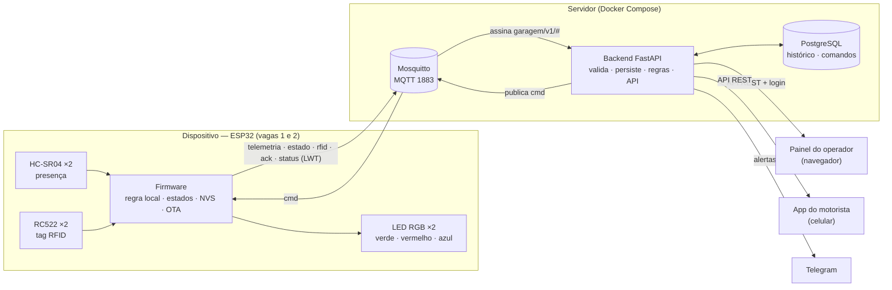
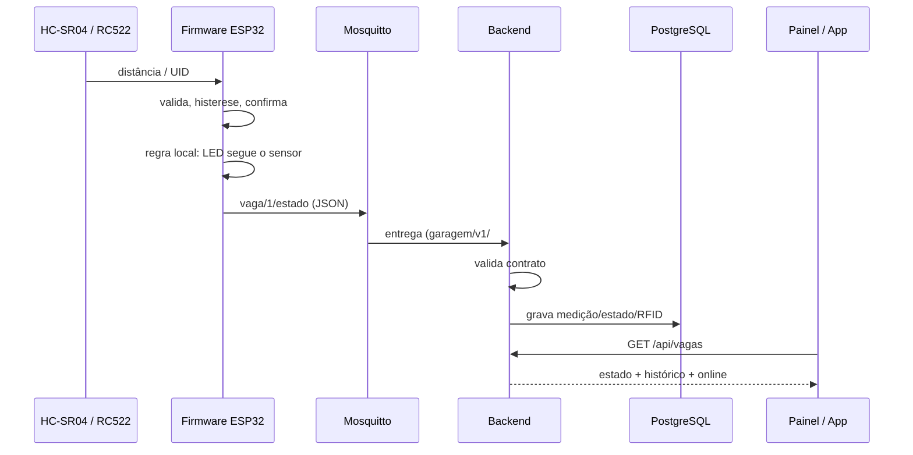
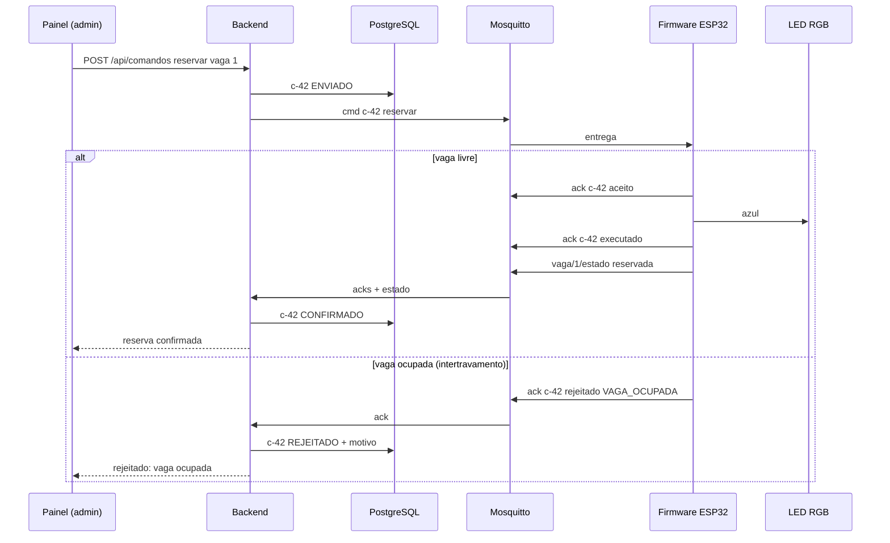
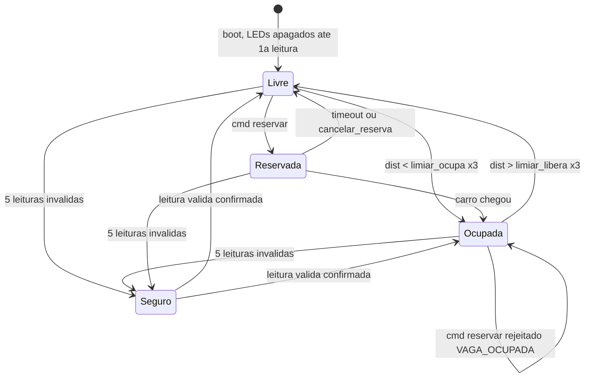

# CP12 — Proposta de upgrade do projeto N1

**Internet das Coisas | Aula 12 — Hardware, firmware-base e contratos** —
Prof. Edson Vaz Lopes

## Identificação

| Campo | Valor |
|---|---|
| Equipe (nº e nome) | Equipe ___ — HorangoTango |
| Projeto (N1 → N3) | Garagem inteligente: monitoramento de vagas → produto **HorangoTango Park** |
| Integrantes presentes | Gustavo Vinicius Taques, Luis Fernando Pereira, João Pedro Angelico, Vynicyus Candido |
| Data / Versão | 20/10/2026 — v1.0 (entrega parcial: seções 1 a 4; seções 5 a 9 em rascunho) |
| Repositório | <https://github.com/VynicyusCandido/iotHorangoTango> |

---

## 1. Ponto de partida: o projeto da N1

| Item | Descrição |
|---|---|
| **Problema e usuário** | Em garagens e estacionamentos, o motorista perde tempo circulando à procura de vaga, e o operador não sabe em tempo real quantas vagas estão livres nem há quanto tempo cada uma está ocupada. **Usuários:** (1) o **motorista**, que quer saber antes de entrar onde há vaga e ser guiado até ela; (2) o **operador/administrador** do estacionamento, que monitora a ocupação, configura o sistema e reserva vagas. |
| **O que funcionou na N1** | Sensor ultrassônico HC-SR04 por vaga com histerese (25/35 cm), confirmação por 3 leituras e detecção de falha do sensor (`erro` após 5 leituras inválidas); ESP32 publicando o estado da vaga em MQTT com *retained*; Last Will (`online`/`offline`) por nó; ESP32 atuador com LEDs verde/vermelho assinando o broker (sensor e atuador sem ligação direta); app web de vagas livres via MQTT/WebSocket; broker Mosquitto local documentado; credenciais Wi-Fi fora do código (`secrets.h` no `.gitignore`). |
| **Limitações conhecidas** | Sem backend, sem banco e sem histórico; a interface fala direto com o broker; payload em texto puro (`livre`/`ocupada`), sem `deviceId`, timestamp nem unidade; nenhum comando do usuário para o dispositivo (só leitura); broker sem autenticação (`allow_anonymous true`); limiares fixos no código (não configuráveis remotamente); os LEDs dependiam do broker, então sem rede a vaga ficava sem indicação; o sistema não sabe **qual** carro está na vaga. |
| **Proposta de valor** | O motorista abre o app no celular, vê na hora quais vagas estão livres e, na garagem, é guiado pelos LEDs: verde = livre, vermelho = ocupada, azul = reservada. Clientes cadastrados (carro com tag RFID) são identificados ao estacionar e podem ter vaga reservada. O operador ganha ocupação em tempo real, histórico de uso (taxa de ocupação, tempo médio de permanência), alerta no celular quando um sensor falha e reservas com confirmação do hardware — sem precisar de alguém circulando para conferir as vagas. |

**Pedido de troca de projeto:** ☐ Sim ☒ **Não** — o projeto da N1 comporta o upgrade.

---

## 2. Upgrade por camada

| Camada | Como era na N1 | Como será na N3 |
|---|---|---|
| **Hardware** | 2 ESP32 (sensor e atuador), HC-SR04 por vaga, LEDs verde/vermelho por vaga. | 1 ESP32 DevKit (WROOM-32) operando 2 vagas: por vaga, 1 HC-SR04 (presença do carro), 1 leitor RFID RC522 (identificação do carro com tag) e 1 LED RGB (verde/vermelho/azul). Divisor de tensão no Echo, alimentação USB 5 V dimensionada, maquete com acabamento. |
| **Firmware** | Dois sketches; leitura com histerese e confirmação; publicação só na mudança; reconexão MQTT; LED só via broker. | Firmware único e não bloqueante: ultrassônico (1 s), RFID (100 ms), LED com **regra local** (funciona sem rede), estados *automático / reservado (manual) / seguro*, execução de comandos com confirmação, configuração persistente em NVS (limiares e tempo de reserva), `deviceId` pelo MAC, horário por NTP (ou "hora não sincronizada"), logs no Serial, OTA. |
| **Comunicação (MQTT)** | Tópicos `garagem/vaga/N` e `garagem/no/<id>/status`, payload texto, sem contrato escrito. | Contrato versionado (`CONTRATOS.md`, v0 → v1 congelado em 27/10): tópicos de telemetria, estado, evento RFID, comando, confirmação e status com Last Will; payload JSON com `v`, `deviceId`, `ts` e unidades; QoS e *retain* justificados por tópico. |
| **Backend** | (não existia) | Serviço FastAPI que assina os tópicos do dispositivo, valida cada mensagem contra o contrato (descarta e registra as inválidas), grava no PostgreSQL, executa as regras remotas, envia notificações e expõe a API REST autenticada usada pela interface. É o **único** que publica comandos. |
| **Banco de dados** | (não existia) | PostgreSQL com histórico de medições e de estados das vagas, leituras RFID, registro de comandos (commandId, origem, ação, envio, resultado, confirmação), alertas e usuários. Esquema versionado (migrações). |
| **Interface** | App web único que assinava o broker direto e mostrava vagas livres. | (1) **Painel do operador** (web, com login): estado atual das vagas, histórico e gráficos, online/offline e último contato do dispositivo, alertas ativos, tags lidas, envio de reserva e alteração de configuração. (2) **App do motorista** (web responsivo no celular): vagas livres em tempo real e destaque da vaga do motorista com tag. Ambos falam só com a API do backend. |
| **Decisão/regra** | Só local: histerese e confirmação no ESP32. | **Local (firmware):** histerese, confirmação, estado seguro em falha de sensor e LED seguindo o sensor mesmo sem rede. **Remota (backend):** reserva expira se o carro não chegar no tempo configurado → backend envia comando `cancelar_reserva`; sensor em `erro` ou dispositivo `offline` por mais de 1 min → alerta e notificação no Telegram. |

---

## 3. Conferência contra o piso R1–R18

| Req. | Como o projeto vai atender |
|---|---|
| **R1** Hardware | ESP32 com **duas entradas de tipos diferentes** por vaga (HC-SR04 = distância/presença; RC522 = identificação RFID) em **dois pontos de medição** (vagas 1 e 2) e **atuador real**: LED RGB por vaga (verde/vermelho/azul) com resistor. Mapa de pinos (`docs/mapa-de-pinos.md`), BOM e esquema elétrico no repositório; maquete com fiação fixa. |
| **R2** Firmware | Laço com `millis()` sem `delay()` longo (ultrassônico a cada 1 s, RFID a cada 100 ms); leituras validadas (faixa 2–400 cm, eco ausente como sentinela, leitor RC522 verificado a cada 5 s); **regra local sem rede**: LED segue o estado confirmado do sensor mesmo com Wi-Fi/broker fora; **estado seguro**: falha de sensor → vaga `erro`, LED vermelho piscando (nunca verde sem certeza); reconexão automática ao Wi-Fi e ao broker refazendo as assinaturas; **configuração persistente** em NVS (limiares e duração da reserva, alteráveis por comando `configurar`); `deviceId` derivado do MAC; timestamp via NTP ou campo `ts_sincronizado: false`; logs no Serial. |
| **R3** Contrato MQTT | `CONTRATOS.md` com árvore de tópicos (telemetria, estado, rfid, cmd, ack, status/LWT), exemplo JSON por tópico com `v`, `deviceId`, `ts` e unidades, comandos aceitos e faixas, confirmação com `commandId` e resultado, catálogo de erros, QoS/retain justificados. v0 na seção 6; v1 congelado em 27/10. |
| **R4** Backend | FastAPI + cliente MQTT assinando `garagem/v1/#`; validação com Pydantic contra o contrato (inválidas descartadas e gravadas em `mensagens_invalidas`); persistência no PostgreSQL; API REST: estado atual, histórico, alertas, envio de comando; único publicador de `cmd`. |
| **R5** Banco de dados | PostgreSQL com tabelas `dispositivos`, `medicoes` (dispositivo, vaga, grandeza, valor, unidade, ts), `estados_vaga`, `leituras_rfid`, `comandos` (commandId, origem, ação, enviado_em, resultado, confirmado_em, motivo), `alertas`, `usuarios`. Migrações versionadas (Alembic). |
| **R6** Interface | Painel web do operador: distância atual (cm) e estado de cada vaga, histórico (tabela e gráfico), último contato e online/offline do dispositivo, alertas ativos, botão de reserva e formulário de configuração (limiares, tempo de reserva). App do motorista: vagas livres e vaga destacada pela tag. |
| **R7** Ciclo de comando | Comando `reservar` (e `cancelar_reserva`, `configurar`) com estados distintos gravados no banco e exibidos na interface: **enviado** (backend publicou) → **recebido** (ESP32 aceitou ou rejeitou, com motivo) → **executado** (LED ficou azul) → **confirmado** (estado `reservada` publicado e refletido na interface). Intertravamento: reservar vaga ocupada ou em erro é rejeitado com `VAGA_OCUPADA` / `VAGA_EM_ERRO`. |
| **R8** Decisão remota | Regra no backend: reserva sem chegada do carro dentro do tempo configurado pelo operador (padrão 15 min, salvo no banco) → backend gera `cancelar_reserva` com o mesmo ciclo do R7 e registra alerta. Segunda regra: vaga em `erro` ou dispositivo `offline` > 1 min → alerta (R15). |
| **R9** Segurança básica | Login com usuário/senha (hash bcrypt) e token JWT na interface e nas rotas de comando; só usuário autenticado envia comando. Credenciais de Wi-Fi e broker no ESP32 em `secrets.h` (ignorado pelo Git, já existe desde a N1); banco, broker e app em `.env` com `.env.example` versionado; Mosquitto com usuário/senha (fim do `allow_anonymous`). |
| **R10** Falhas testadas | Plano com 4+ cenários, cada um com provocação, esperado, observado e evidência (log/vídeo/print): (1) queda do Wi-Fi → LED segue sensor local, reconecta e republica; (2) broker indisponível → idem, interface mostra offline via LWT; (3) falha de sensor (Echo desconectado) → `erro`, estado seguro e alerta; (4) comando inválido/duplicado → rejeitado com código, `commandId` repetido não reexecuta. Extra: RC522 desconectado → identificação para, vaga segue funcionando. |
| **R11** Entrega executável | README com pré-requisitos, `.env.example`, `docker compose up` para broker/backend/banco, gravação do firmware (Arduino IDE/arduino-cli) e reaproveitamento declarado; release/tag `v1.0` da versão defendida; commits de todos os integrantes. |
| **R12** Orquestração | `compose.yaml` com `mosquitto` (config + senhas), `postgres` (volume persistente), `backend` (FastAPI, também serve painel e app). Variáveis sensíveis via `.env`. Um único `docker compose up -d`. |
| **R13** Múltiplos dispositivos | **Pendência — não atendido no desenho atual.** A equipe decidiu usar **um único ESP32** para as duas vagas, o que dá um só `deviceId`. O backend, o contrato (`deviceId` em todo tópico) e a interface já são desenhados para N dispositivos. Alternativa avaliada para atender: um ESP32 por vaga com o mesmo firmware (a placa reserva já está na BOM). Decisão a fechar com o professor até o CP13 (27/10). |
| **R14** Painel analítico | Gráficos na própria interface (Chart.js) com dados reais do banco: taxa de ocupação por hora do dia, tempo médio de permanência por vaga, uptime do dispositivo e tempo em `erro`. |
| **R15** Notificação externa | Bot do Telegram acionado pelo backend quando um sensor entra em `erro`, o dispositivo fica `offline` > 1 min ou uma reserva expira. |
| **R16** Segurança avançada | Perfis com permissões diferentes na API e na interface: **operador** (visualiza estado, histórico e alertas) e **administrador** (reserva vagas, altera configuração, gerencia tags). Verificado no backend em cada rota. TLS no MQTT avaliado como extra; se não implementado, justificativa registrada (rede local isolada). |
| **R17** OTA | ArduinoOTA (ou `HTTPUpdate` baixando o binário do backend), com senha de OTA em `secrets.h`. Demonstração: gravar nova versão pela rede e conferir a versão publicada no status. |
| **R18** Testes e CI | `pytest` no backend: validação de contrato (payloads válidos/ inválidos), ciclo de comando e regra de expiração da reserva; GitHub Actions rodando os testes (e compilando o firmware com `arduino-cli`) a cada push/PR. |

---

## 4. Arquitetura-alvo

### Diagrama de blocos



### Fluxo do dado (sensor → firmware → MQTT → backend → banco → interface)



### Fluxo do comando (interface → backend → MQTT → firmware → atuador → confirmação)



---

> **Seções 5 a 9 — rascunho.** Entrega completa até o fim da Aula 13
> (27/10/2026, 22h30), depois da teoria de hardware seguro,
> firmware-base e contratos.

## 5. Hardware: desenho e dimensionamento

### 5.1 Verificação elétrica (calculada)

| Verificação | Valor calculado/esperado | Como será garantido |
|---|---|---|
| Tensão no pino 3V3 e 5V/VIN usados | VIN = 5,0 V (USB); 3V3 = 3,3 V do regulador AMS1117 da placa (até 1 A). Carga no 3V3 ≈ ESP32 (pico ≈240 mA com Wi-Fi) + 2× RC522 (≈26 mA cada) ≈ 300 mA. | RC522 só no 3V3; HC-SR04 no VIN; fonte USB 5 V / 1 A (consumo total estimado ≈350 mA de pico). |
| Corrente estimada do(s) atuador(es) | LED vermelho: (3,3 − 2,0) / 220 Ω ≈ 5,9 mA. Verde/azul: (3,3 − 3,0) / 68 Ω ≈ 4,4 mA. Um canal aceso por vaga → ≤ 6 mA por GPIO, ≤ 12 mA no total. | Resistor em série em cada canal; abaixo do limite recomendado do GPIO (≈20 mA) e do absoluto (40 mA). |
| GND comum entre todas as fontes previstas | Uma única fonte (USB). | Trilha de GND única na protoboard ligando ESP32, HC-SR04, RC522 e LEDs. |
| Maior tensão que chegará a um GPIO (qual sensor?) | HC-SR04 Echo = 5 V → divisor 1 kΩ / 2 kΩ: 5 × 2/3 = **3,33 V** nos GPIO 34/35. RC522 opera em 3,3 V. | Divisor em cada Echo (ou HC-SR04P de 3,3 V, sem divisor). Conferir com multímetro na montagem. |
| Proteção planejada para carga indutiva (se houver) | Não há carga indutiva (sem relé, motor ou bomba). | — |
| Estado seguro definido para o atuador no boot | LEDs **apagados** desde o `setup()` (pinos em `OUTPUT LOW`) até o primeiro estado confirmado do sensor; nenhum LED em pino de strapping. | Pinos dos LEDs (32, 33, 27, 13, 16, 17) sem função de boot; firmware inicializa antes de qualquer conexão. |

Conferir no desenho:

- ☒ Nenhuma carga (motor, bomba, relé, cooler, fita de LED) alimentada diretamente por GPIO — só LEDs indicadores com resistor (≤ 6 mA).
- ☒ Carga indutiva com diodo de roda livre — não se aplica (sem carga indutiva).
- ☒ Nenhum sinal de 5 V ligado direto a um GPIO — divisor no Echo do HC-SR04.
- ☒ Nenhum uso de GPIO 6–11; nenhum atuador em pino de strapping. O GPIO 5 (strapping) é usado só como SS do RC522 — é o SS padrão do SPI e tem pull-up interno, que mantém o leitor desselecionado e o nível exigido no boot.
- ☒ Sensores analógicos no ADC1 — não se aplica (nenhum sensor analógico; HC-SR04 e RC522 são digitais).

**Esquema elétrico:** pendente (Fritzing), versionado em `docs/` até 27/10.

### 5.2 BOM e mapa de pinos

| Item | Conteúdo |
|---|---|
| BOM — o que já tem | 1× ESP32 DevKit 30 pinos (ESP32-WROOM-32, USB-C, CP2102). *(Equipe completar.)* |
| BOM — o que falta comprar/providenciar | 1× ESP32 reserva; 2× HC-SR04; 2× RC522 + 4–6 tags 13,56 MHz (MIFARE 1K); 2× LED RGB catodo comum; resistores 2× 220 Ω, 4× 68–100 Ω, 2× 1 kΩ, 2× 2 kΩ; 2 protoboards 830 furos; jumpers; cabo USB-C de dados; fonte USB 5 V / 1 A; roteador Wi-Fi 2,4 GHz; servidor (PC/notebook/Raspberry Pi); maquete (base, suportes, carrinhos). |
| Caminho do mapa de pinos no repositório | `docs/mapa-de-pinos.md` |

### 5.3 Fluxograma do firmware

Estados de cada vaga. A regra local roda em todos os estados, com ou sem rede.



| Estado | Modo | LED | Saída |
|---|---|---|---|
| Livre / Ocupada | **Automático** (regra local, funciona sem rede) | verde / vermelho | sensor confirma mudança (3 leituras) |
| Reservada | **Manual** (por comando) | azul | **timeout** da reserva (`duracao_min`, padrão 15 min, em NVS — conta mesmo sem rede), `cancelar_reserva` ou carro detectado |
| Seguro | **Seguro** (falha de sensor, publica `erro`) | vermelho piscando, nunca verde | leitura válida confirmada |

**Intertravamento:** `reservar` só é aceito com a vaga **Livre**; em Ocupada → `VAGA_OCUPADA`, em Seguro → `VAGA_EM_ERRO`.

Paralelo aos estados, o laço principal (sem `delay()` longo): verifica Wi-Fi/MQTT e reconecta refazendo a assinatura de `cmd` → lê ultrassônico (1 s) → lê RFID (100 ms) → atualiza LED → publica pendentes → processa comandos (aceita/rejeita, executa, confirma) → telemetria periódica (10 s). Detalhes de cada módulo em `docs/fluxograma-firmware.md`.

---

## 6. Contrato v0

Ainda não congelado (v1 em 27/10, em `CONTRATOS.md`).

**Árvore de tópicos** (`{id}` = `deviceId`, ex.: `esp32-garagem-240ac4000110`):

| Tópico | Direção | Conteúdo | QoS | Retain | Motivo |
|---|---|---|:-:|:-:|---|
| `garagem/v1/{id}/telemetria` | ESP32 → | distância de cada vaga (cm), RSSI, uptime — a cada 10 s | 0 | não | Periódica; perder uma amostra não importa. |
| `garagem/v1/{id}/vaga/{n}/estado` | ESP32 → | `livre` / `ocupada` / `reservada` / `erro` | 1 | sim | Mudança de estado não pode se perder; novo assinante recebe o atual. |
| `garagem/v1/{id}/rfid` | ESP32 → | UID lido e vaga | 1 | não | Evento: não deve ser reentregue como se fosse novo. |
| `garagem/v1/{id}/cmd` | backend → | `reservar`, `cancelar_reserva`, `configurar` | 1 | não | Comando antigo não pode ser executado ao reconectar. |
| `garagem/v1/{id}/ack` | ESP32 → | `aceito` / `rejeitado` / `executado` + `commandId` | 1 | não | Cada confirmação é um evento único. |
| `garagem/v1/{id}/status` | ESP32 / LWT → | `online` / `offline`, versão do firmware | 1 | sim | Last Will; interface sabe se o dispositivo está vivo. |

**Exemplos de payload:**

```json
// garagem/v1/esp32-garagem-240ac4000110/vaga/1/estado
{ "v": 1, "deviceId": "esp32-garagem-240ac4000110", "ts": "2026-10-20T21:30:05Z",
  "vaga": 1, "estado": "ocupada", "distancia": { "valor": 12.4, "unidade": "cm" } }

// garagem/v1/esp32-garagem-240ac4000110/cmd
{ "v": 1, "commandId": "c-0042", "ts": "2026-10-20T21:31:00Z",
  "acao": "reservar", "vaga": 1, "duracao_min": 15 }

// garagem/v1/esp32-garagem-240ac4000110/ack
{ "v": 1, "deviceId": "esp32-garagem-240ac4000110", "ts": "2026-10-20T21:31:01Z",
  "commandId": "c-0042", "resultado": "rejeitado", "erro": "VAGA_OCUPADA" }
```

**Comandos aceitos e faixas:** `reservar` (`vaga` 1–2, `duracao_min` 1–60); `cancelar_reserva` (`vaga` 1–2); `configurar` (`limiar_ocupa_cm` 2–200, `limiar_libera_cm` > `limiar_ocupa_cm` + 2, `duracao_reserva_min` 1–60).

**Códigos de erro:** `VAGA_OCUPADA`, `VAGA_EM_ERRO`, `VAGA_INEXISTENTE`, `SEM_RESERVA`, `PARAMETRO_INVALIDO`, `ACAO_DESCONHECIDA`, `COMANDO_DUPLICADO`, `PAYLOAD_INVALIDO`.

Sem `ts` sincronizado (NTP indisponível), o dispositivo envia `"ts": null, "ts_sincronizado": false, "uptime_ms": ...`.

---

## 7. Tecnologias pretendidas

| Camada | Tecnologia escolhida | Justificativa |
|---|---|---|
| Backend | Python 3.12 + FastAPI + aiomqtt | Sugestão da disciplina; validação de contrato com Pydantic; documentação automática da API (OpenAPI); `pytest` simples para R18. |
| Banco de dados | PostgreSQL 16 + SQLAlchemy/Alembic | Relacional recomendado; consultável ao vivo (psql); migrações versionadas para R5. |
| Interface | Web (HTML/CSS/JS) servida pelo backend + Chart.js; app do motorista responsivo (PWA) | Evolui o app da N1 sem build; roda no navegador do celular sem instalação; gráficos do R14 sem ferramenta externa. |
| Broker MQTT | Eclipse Mosquitto 2 | Já usado na N1; leve, aberto, suporta usuário/senha, ACL, WebSocket e TLS. |
| Orquestração (Docker Compose) | Docker Compose: `mosquitto`, `postgres`, `backend` | Sobe os três serviços com `docker compose up -d`; segredos em `.env`. |
| Firmware | Arduino (ESP32 core 3.x) + PubSubClient, MFRC522, ArduinoJson, Preferences (NVS), ArduinoOTA | Base já existente na N1; bibliotecas abertas e consolidadas. |
| Notificação | Telegram Bot API | Gratuita, simples (uma chamada HTTP), chega no celular do operador. |
| CI | GitHub Actions | Integrado ao GitHub; roda `pytest` e compila o firmware a cada push/PR. |

Nenhuma plataforma fechada (Blynk, Arduino IoT Cloud etc.).

---

## 8. Cronograma, riscos e divisão de responsabilidades

### 8.1 Cronograma até a N3

| Data | Marco | O que a equipe entrega |
|---|---|---|
| 27/10 | CP12 completo (fim da Aula 13) + contrato congelado v1 | PDF completo; `CONTRATOS.md` v1; esquema elétrico; fluxograma do firmware; modelo de dados; esboço das telas; plano de testes dos 4 cenários; repositório atualizado com commit de todos. |
| 03/11 | N2 | T2 (este documento + repositório) e prova individual P2. |
| 10/11 – 24/11 | Unidade 3 | **10/11:** hardware montado na maquete, firmware com contrato v1, regra local, NVS (R1–R3); `compose.yaml` com broker + banco + backend esqueleto (R12). **17/11:** backend validando e persistindo, API, painel com login e ciclo de comando (R4–R7, R9). **24/11:** regra remota, Telegram, gráficos, perfis, OTA, testes + CI, falhas testadas com evidência (R8, R10, R14–R18). |
| 01/12 | N3 | Release `v1.0` no GitHub; README executável (R11); defesa do produto funcionando. |

### 8.2 Riscos

| Risco | Mitigação |
|---|---|
| **R13 não atendido** com um único ESP32. | Backend e contrato já suportam N dispositivos; decidir com o professor até 27/10; placa reserva na BOM permite dividir uma vaga por ESP32 sem mudar o firmware. |
| Atraso na compra de RC522/tags/LED RGB. | Comprar até 27/10; RFID é complementar — o sistema funciona só com ultrassônico; tags podem ser publicadas manualmente (`mosquitto_pub`) nos testes. |
| Dois RC522 no mesmo SPI não se entenderem. | SS separados, todos em nível alto antes do `SPI.begin`; verificação periódica com reinicialização; testar cedo (10/11). |
| Rede da faculdade bloqueia ESP32/celulares (WPA2-Enterprise, isolamento). | Roteador 2,4 GHz próprio para a demonstração. |
| Calibração do ultrassônico na maquete. | Limiares configuráveis pela interface (NVS) — ajuste sem regravar. |
| Escopo grande (R12–R18) para 3 aulas. | Priorizar R1–R11 em 10/11 e 17/11; R12 desde o início (compose); R14–R18 em 24/11; divisão por camada. |
| ESP32 único é ponto único de falha. | LWT + alerta; estado seguro; regra local sem rede; placa reserva. |

### 8.3 Divisão de responsabilidades

*(Sugestão — equipe confirmar.)*

| Integrante | Responsabilidade principal até a entrega completa (Aula 13) |
|---|---|
| Gustavo Vinicius Taques | Hardware: esquema elétrico (Fritzing), verificação elétrica, BOM |
| Luis Fernando Pereira | Firmware: fluxograma de estados, mapa de pinos, contrato v1 (`CONTRATOS.md`) |
| João Pedro Angelico | Backend e banco: modelo de dados, endpoints da API, regra remota, `compose.yaml` planejado |
| Vynicyus Candido | Interface: esboço das telas (painel e app do motorista), plano de testes de falha, repositório/README |

---

## 9. Repositório (GitHub)

| Item | Valor |
|---|---|
| Link do repositório | <https://github.com/VynicyusCandido/iotHorangoTango> |
| Hash do commit entregue | *(preencher após o commit final)* |

| Integrante | Usuário GitHub (com commit próprio no repositório) |
|---|---|
| Gustavo Vinicius Taques | *(preencher)* |
| Luis Fernando Pereira | *(preencher)* |
| João Pedro Angelico | *(preencher)* |
| Vynicyus Candido | VynicyusCandido |

Conteúdo no repositório: `README.md` (projeto, problema, usuário, estado atual, direção do upgrade), `docs/CP12.md` (este documento, fonte do PDF), `docs/adr/` (decisões), `docs/fluxograma-firmware.md`, `docs/mapa-de-pinos.md`, `src/garagem/` (firmware).
