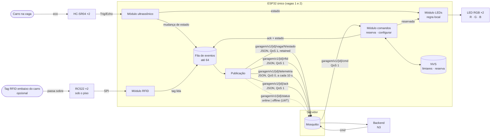
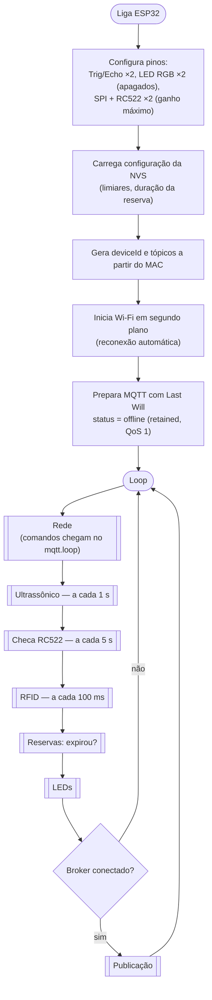
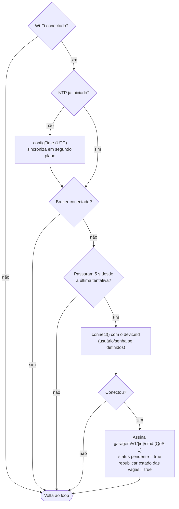
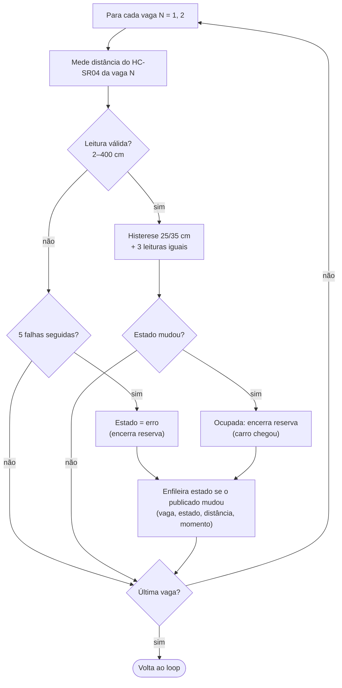
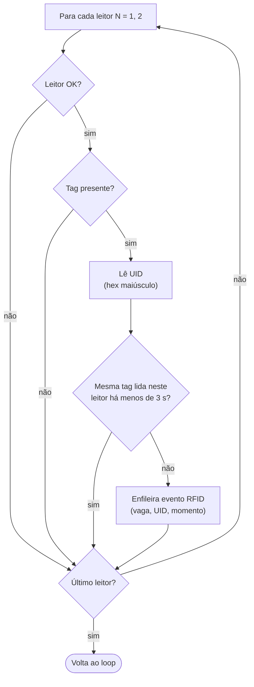
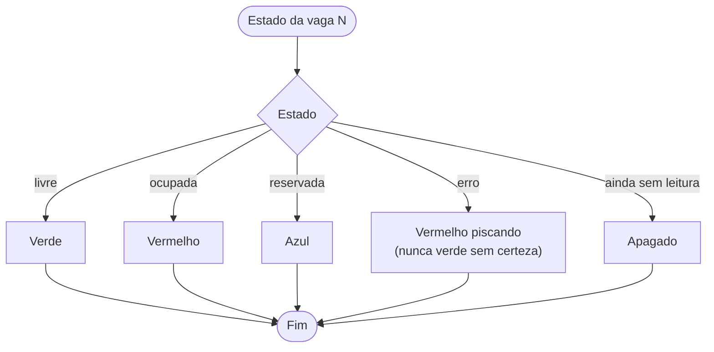
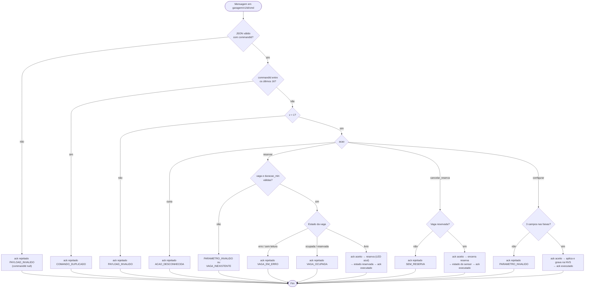
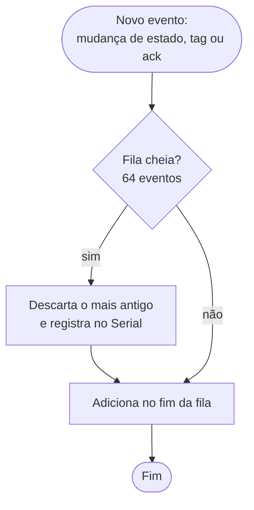
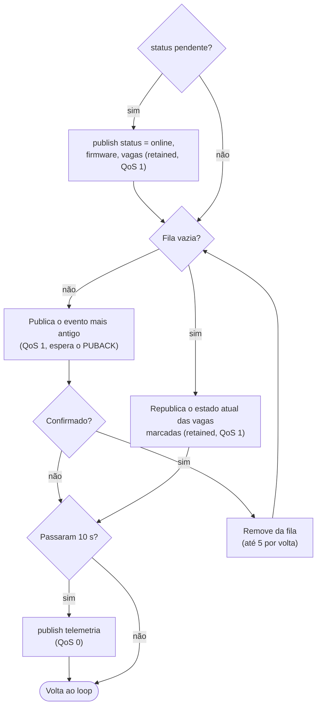

# Fluxograma de firmware

Um único ESP32 opera as duas vagas: lê os 2 HC-SR04 e os 2 RC522,
acende os 2 LEDs RGB pela regra local e publica no broker seguindo o
contrato MQTT v1 ([CONTRATOS.md](../CONTRATOS.md)). Recebe comandos do
backend (reserva e configuração). Mudanças de estado, tags lidas e
respostas a comandos passam por uma fila, que guarda o que acontece com
o sistema fora do ar (ver [ADR 0001](adr/0001-rfid-e-app-motorista.md),
[ADR 0003](adr/0003-firmware-v1-fila-de-eventos.md) e
[ADR 0004](adr/0004-comandos-reserva-e-nvs.md)).

```
            ┌──────────────── ESP32 (vagas 1 e 2) ─────────────────┐
HC-SR04 ×2 ─┤ ultrassônico ─┐                                       │
RC522   ×2 ─┤ RFID ─────────┼─► fila de eventos ─► publica (QoS 1) ─┼──┐
LED RGB ×2 ◄┤ LEDs ◄────────┘  (regra local, sem rede)              │  │
            └───────────────────────────────────────────────────────┘  │
                                                                       ▼
                                                  Servidor: Mosquitto ──► backend (N3)
```

## Visão geral

`{id}` = `deviceId` (ex.: `esp32-garagem-240ac4000110`, derivado do MAC).



## Firmware do ESP32

Laço único e sem bloqueio: sensores e LEDs rodam a cada volta, com ou
sem rede. A publicação só acontece com o broker conectado; antes disso,
os eventos esperam na fila.



### Rede (sem bloqueio)



### Módulo ultrassônico (a cada 1 s, vaga 1 e depois vaga 2)

Os dois sensores disparam um de cada vez para não interferirem.



### Módulo RFID (a cada 100 ms, RC522 da vaga 1 e depois da vaga 2)

Enfileira toda leitura; não sabe nem decide o estado da vaga.



A cada 5 s o firmware confere se os RC522 respondem. Se algum parou,
reinicia os dois (o pino de reset é comum).

### Módulo LEDs (regra local, a cada volta)

Segue o estado da vaga (sensor + reserva) no próprio ESP32, com ou sem
rede. Falha no sensor vence a reserva.



### Módulo comandos (callback do `mqtt.loop()`)

Não publica nada: as respostas entram na fila, na ordem
`aceito` → estado → `executado`.



A reserva expira pelo tempo (`duracao_min` ou o padrão configurado),
contado no ESP32 mesmo sem rede; ao expirar, a vaga volta ao estado do
sensor e o novo estado entra na fila.

### Fila de eventos



O momento do evento é registrado quando ele acontece: horário real (se
o NTP já sincronizou) e uptime. Evento registrado antes da
sincronização ganha o horário real na publicação, calculado pelo uptime.
Se o relógio nunca sincronizou, vai `"ts": null` com o `uptime_ms`.

### Publicação (só com o broker conectado)



Eventos de estado vão para `garagem/v1/{id}/vaga/N/estado` (retained);
tags para `garagem/v1/{id}/rfid`; respostas a comandos para
`garagem/v1/{id}/ack`. Como a fila sai em ordem, o último
estado publicado de cada vaga é sempre o atual.

## Assinantes

Na N3 quem assina os tópicos do dispositivo é o **backend**: valida cada
mensagem contra o contrato, grava no PostgreSQL e cruza a tag lida com a
vaga ocupada. Painel do operador e app do motorista falam só com a API
do backend.

O painel da N1 (`app/index.html`) ainda assina os tópicos antigos
(`garagem/vaga/#`, texto puro) e não mostra os dados do firmware v1.
