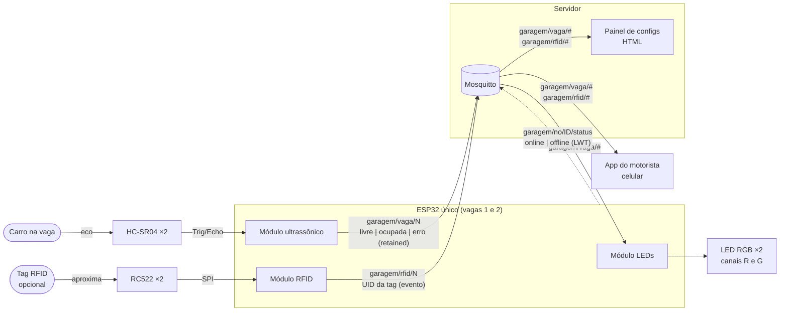
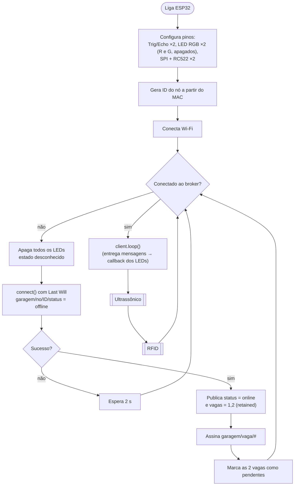
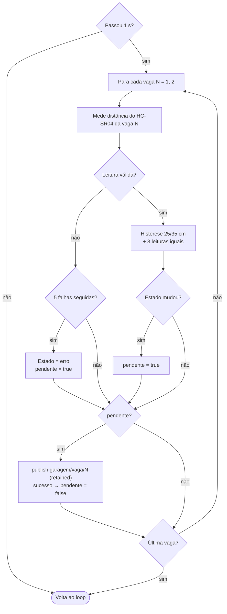
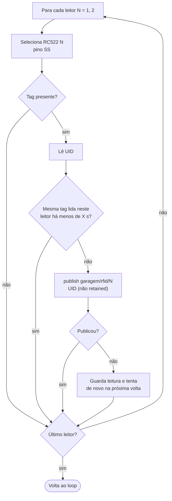
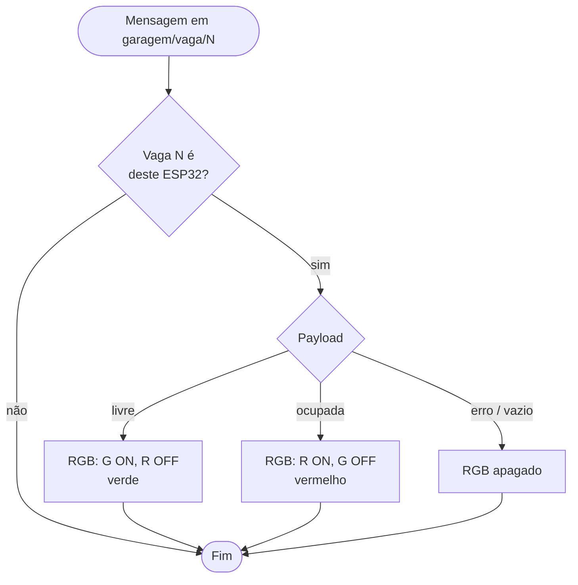
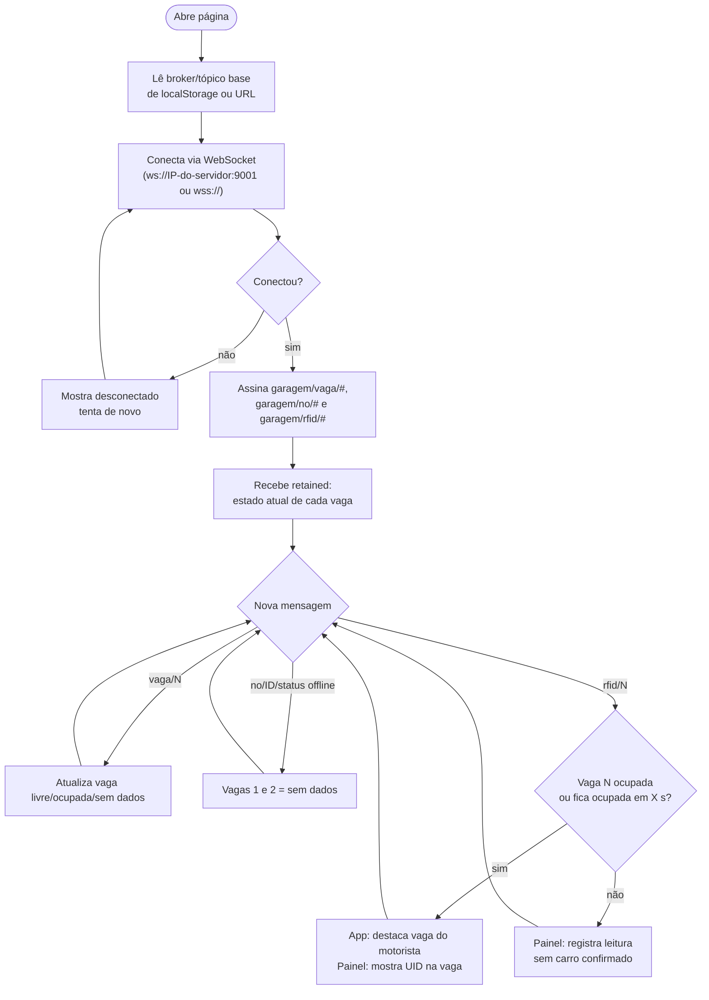

# Fluxograma de firmware

Um único ESP32 opera as duas vagas: lê os 2 HC-SR04 e os 2 RC522,
publica no broker e aciona os 2 LEDs RGB a partir do que assina do broker
(ver [ADR 0001](adr/0001-rfid-e-app-motorista.md)).

```
            ┌──────────────── ESP32 (vagas 1 e 2) ────────────────┐
HC-SR04 ×2 ─┤ ultrassônico ──► publica garagem/vaga/N ─────────────┼──┐
RC522   ×2 ─┤ RFID         ──► publica garagem/rfid/N ─────────────┼──┤
LED RGB ×2 ◄┤ LEDs         ◄── assina  garagem/vaga/# ◄────────────┼──┤
            └──────────────────────────────────────────────────────┘  │
                                                                      ▼
                          Servidor: Mosquitto ──┬──► Painel de configs (mesmo servidor)
                                                └──► App do motorista (celular)
```

## Visão geral (pub/sub)



## Firmware do ESP32

Loop único e não bloqueante. Os três módulos rodam em sequência a cada
volta; o RFID nunca lê nem altera o estado da vaga, e os LEDs só mudam
pelo que chega do broker.



### Módulo ultrassônico (a cada 1 s, vaga 1 e depois vaga 2)

Mesma lógica do antigo `sensor.ino`; os dois sensores disparam um de
cada vez para não interferirem.



### Módulo RFID (a cada volta, RC522 da vaga 1 e depois da vaga 2)

Publica toda leitura; não sabe nem decide o estado da vaga.



### Módulo LEDs (callback MQTT)

Chamado pelo `client.loop()` quando chega mensagem em `garagem/vaga/#`,
inclusive as publicadas pelo próprio ESP32. Ignora `garagem/rfid/#`.



## Subscribers web (painel no servidor e app no celular)

Correlação entre tag e ocupação acontece aqui, não no firmware.


